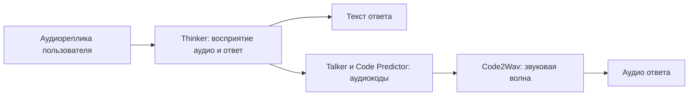

# План развёртывания Qwen3-Omni-30B-A3B-Instruct на одной GPU 80 ГБ

> Это первоначальное исследование BF16-профиля. Для установки используйте
> [актуальный комплект с INT4 и пошаговой инструкцией](../speech-to-speech/README.md).
> Команды BF16 ниже не являются основным сценарием развёртывания.

Дата исследования: 27 октября 2026 года. Код `tts-stt` изучен на коммите
`d859c76`. Это план пилотного развёртывания, а не отчёт об успешном запуске:
локально доступна RTX 3050 с 4 ГБ, целевой сервер не проверялся.

**Предлагаемый путь:** отдельное окружение vLLM-Omni, полный BF16 checkpoint,
все три стадии на одной GPU, одна активная генерация и короткие реплики.
Работоспособность и задержку на 80 ГБ нужно подтвердить замерами. Для начала
использовать завершённую аудиореплику на входе и текст с WAV на выходе; затем
добавлять потоковую выдачу звука и управление разговором.

## Как устроено существующее развёртывание

| Часть | Реализация в репозитории | Поведение |
| --- | --- | --- |
| STT | [`gigaam/api.py`](../gigaam/api.py) | FastAPI, `POST /transcribe`, JSON с текстом; базовая модель `v3_e2e_rnnt` |
| TTS | [`voxcpm2/api.py`](../voxcpm2/api.py) | FastAPI, `POST /synthesize`, текст → готовый WAV; `openbmb/VoxCPM2` |
| Контейнеры | [`docker-compose.yaml`](../docker-compose.yaml) | Сборка двух отдельных образов, порты хоста 8000/8001, постоянные volumes весов |
| GPU | [`docker-compose.gpu.yaml`](../docker-compose.gpu.yaml) | `DEVICE=cuda` и `gpus: all` для обоих сервисов |
| Наблюдаемость | [`observability/prometheus.yml`](../observability/prometheus.yml) | Prometheus собирает `/metrics` двух API; Grafana опубликована на 18473 |
| Проверки | [`.github/workflows/api.yml`](../.github/workflows/api.yml) | HTTP-тесты без весов; успешный CI не подтверждает работу модели на GPU |

В Dockerfile используются Python 3.14 для GigaAM и 3.12 для VoxCPM2,
`uv sync --locked`, один worker Uvicorn. На Linux x86_64 PyTorch берётся из
CUDA 12.8 index. У каждого сервиса своё окружение и `uv.lock`.

GigaAM загружает базовую модель при старте приложения; дополнительные модели
кешируются с вытеснением, по умолчанию до двух. VoxCPM2 загружается при первом
синтезе и сохраняет голосовые референсы в volume. Его `/health` может вернуть
200 и `loaded=false`: это ещё не проверка готовности инференса. Оба API
сериализуют работу с моделью блокировкой в процессе.

Существующая команда запуска на NVIDIA-сервере из корня проекта:

```bash
docker compose -f docker-compose.yaml -f docker-compose.gpu.yaml up -d --build
```

Это описание доступной конфигурации, а не восстановленная история эксплуатации.
В README развёртывание поручено серверной команде; логов запуска, характеристик
её GPU и результатов нагрузочных испытаний здесь нет. Упомянутого `../ai-tutor`
в локальном workspace тоже нет, поэтому клиентский голосовой тракт не проверен.

## Что меняется с Qwen3-Omni



Выбираем именно `Qwen/Qwen3-Omni-30B-A3B-Instruct`. Русский поддерживается
на входе и в синтезе. Вариант Thinking не содержит полного голосового выхода.
Обозначение A3B характеризует активную часть MoE при вычислениях: хранить
в памяти только 3 млрд параметров вместо всего набора экспертов нельзя.
Архитектура и возможности описаны в [README Qwen](https://github.com/QwenLM/Qwen3-Omni/blob/e4235853125589c789f06a2dd83e9f4126df5e9d/README.md).

Обычный `vllm serve` из раздела Qwen про vLLM обслуживает Thinker. Для
полного голосового выхода нужен vLLM-Omni и запуск с `--omni`.
Его [штатный конфиг](https://github.com/vllm-project/vllm-omni/blob/9842ebc17cf1d9c6b440ecb6a79039162f68a1dd/vllm_omni/deploy/qwen3_omni_moe.yaml)
размещает Thinker на GPU 0, Talker и Code2Wav на GPU 1 и отмечен как проверенный
на двух H100. Просто скопировать стандартную команду на однокарточный сервер
недостаточно.

В новом тракте Qwen выполняет понимание речи, формирование ответа и синтез.
GigaAM и VoxCPM2 для него не требуются. Их можно сохранить как отдельный
вариант продукта, но на время пилота освободить от них целевую GPU.
Смена `BACKEND_STT_URL` не подключит Omni: текущие `/transcribe` и `/synthesize`
имеют другую семантику. Нужен отдельный вызов диалоговой модели из backend.

## Оценка памяти и начальные ограничения

В [индексе checkpoint](https://huggingface.co/Qwen/Qwen3-Omni-30B-A3B-Instruct/blob/26291f793822fb6be9555850f06dfe95f2d7e695/model.safetensors.index.json)
указаны 35 259 818 545 параметров и `total_size=70519637090` байт.
Расчёт даёт **70,52 GB = 65,68 GiB только тензоров весов** всего checkpoint.
Фактическое размещение конкретным движком и пик памяти нужно измерить.

| Расход | Что закладывать |
| --- | --- |
| Веса | Около 65,7 GiB до накладных расходов загрузчика |
| KV-кеш | Зависит от контекста, числа последовательностей и стадии |
| Рабочие буферы | Активации аудиоэнкодера, CUDA-контексты, временные тензоры, декодер звука |
| CUDA graphs | На первом этапе отключить; включать после замеров |
| Свободная память | Сверить реальную ёмкость через `nvidia-smi`, учитывать другие процессы и MIG |

На GPU с доступными 80 GiB арифметический остаток после весов — около 14,3 GiB;
это не гарантированный запас для запросов. GB и GiB не взаимозаменяемы.
В Qwen README есть оценка 78,85 GB для 15 секунд **видео** при Transformers,
BF16 и FlashAttention 2. Она не является бенчмарком аудиодиалога или гарантией
работы vLLM-Omni на 80 ГБ.

Начальные ограничения пилота — наши инженерные настройки, не лимиты модели:

- Одна NVIDIA A100/H100 80 ГБ целиком, без соседних GPU-сервисов.
- BF16, tensor parallel size 1; одна активная генерация на уровне gateway.
- Аудиовход сначала 5–10 секунд; один аудиофрагмент, без видео и изображений.
- Контекст Thinker 4096 токенов; короткий ответ в 1–2 предложения.
- Ограниченная очередь; длинные записи и лишние запросы отклонять до движка.
- Для планирования сервера: RAM 128 ГБ и SSD от 150 ГБ свободного места.
  Это резерв для загрузки, окружения и кешей, а не опубликованный минимум.

Установить `max_num_seqs=1` недостаточно для ограничения очереди и размера
загружаемого аудио: это отдельно реализует принимающий запросы backend.

## Пилот: подготовка окружения

Сначала зафиксировать модель GPU, доступную память и драйвер:

```bash
nvidia-smi --query-gpu=name,memory.total,memory.free,driver_version --format=csv
```

Не ставить Omni в окружения GigaAM/VoxCPM2. Ниже выбран конкретный source
snapshot Omni и соответствующий ему vLLM. По его
[инструкции установки](https://github.com/vllm-project/vllm-omni/blob/9842ebc17cf1d9c6b440ecb6a79039162f68a1dd/docs/getting_started/installation/gpu/cuda.inc.md)
этот стек использует Python 3.12, PyTorch 2.13 и CUDA 13.0; нужен совместимый
драйвер. CUDA 12.8 существующих сервисов не задаёт совместимость нового стека.

Команды для отдельного Linux x86_64 окружения на целевом сервере
(предполагаются установленные `git`, `uv` и системный `ffmpeg`):

```bash
mkdir -p ~/qwen3-omni-pilot
cd ~/qwen3-omni-pilot
git clone https://github.com/vllm-project/vllm-omni.git
cd vllm-omni
git checkout 9842ebc17cf1d9c6b440ecb6a79039162f68a1dd
uv venv --python 3.12 --seed
source .venv/bin/activate
uv pip install --torch-backend=cu130 \
  'vllm @ https://wheels.vllm.ai/5df63a7203cdb9328d824a27b682e77c7b9928be/vllm-0.32.0-cp38-abi3-manylinux_2_28_x86_64.whl'
uv pip install -e .
uv pip check
uv pip freeze > ../pilot-resolved.txt
python -c 'import torch; print(torch.__version__, torch.version.cuda, torch.cuda.is_bf16_supported())'
```

`pilot-resolved.txt` фиксирует реально разрешённые зависимости для последующего
образа. Это ещё не lock с хешами артефактов. Не смешивать приведённый source
snapshot с произвольным образом `latest` или со старой веткой `qwen3_omni`
из первоначальной model card. При выборе другого релиза заново сверить CLI,
формат конфигурации и совместимость зависимостей.

## Пилот: размещение трёх стадий на GPU 0

Создать в корне клона vLLM-Omni файл `qwen3-single-80gb.yaml`:

```yaml
base_config: vllm_omni/deploy/qwen3_omni_moe.yaml
stages:
  - stage_id: 0
    devices: "0"
    tensor_parallel_size: 1
    dtype: bfloat16
    gpu_memory_utilization: 0.82
    max_num_seqs: 1
    max_model_len: 4096
    max_num_batched_tokens: 4096
    enforce_eager: true
    enable_prefix_caching: false
    limit_mm_per_prompt:
      audio: 1
      image: 0
      video: 0
  - stage_id: 1
    devices: "0"
    tensor_parallel_size: 1
    dtype: bfloat16
    gpu_memory_utilization: 0.10
    max_num_seqs: 1
    max_model_len: 4096
    max_num_batched_tokens: 4096
    enforce_eager: true
  - stage_id: 2
    devices: "0"
    dtype: bfloat16
    gpu_memory_utilization: 0.03
    max_num_seqs: 1
    enforce_eager: true
```

**Это экспериментальные бюджеты, не проверенный профиль 80 ГБ.** Доли от полной
памяти устройства дают суммарно 0,95: примерно 65,6 / 8 / 2,4 GiB на GPU
80 GiB. Они ограничивают бюджеты стадий, но не создают аппаратную изоляцию
памяти. При инициализации есть дополнительные пики и проверки свободной памяти.
Нужно сохранить логи загрузки каждой стадии и скорректировать распределение.
Нельзя задавать каждой стадии по 0,9 на общей карте.

Файл наследует межстадийные соединения и настройки генерации штатного профиля.
Механизм overlay описан в
[инструкции online serving](https://github.com/vllm-project/vllm-omni/blob/9842ebc17cf1d9c6b440ecb6a79039162f68a1dd/examples/online_serving/qwen3_omni/README.md).
При запуске из другого каталога использовать абсолютный путь в `base_config`.

Из того же каталога с активированным окружением:

```bash
export HF_HOME="$HOME/qwen3-omni-pilot/hf-cache"
CUDA_VISIBLE_DEVICES=0 vllm serve Qwen/Qwen3-Omni-30B-A3B-Instruct \
  --omni \
  --revision 26291f793822fb6be9555850f06dfe95f2d7e695 \
  --host 127.0.0.1 --port 8091 \
  --deploy-config "$PWD/qwen3-single-80gb.yaml"
```

Первая загрузка скачает десятки гигабайт весов. В отдельном терминале:

```bash
curl --fail http://127.0.0.1:8091/health
curl --fail http://127.0.0.1:8091/v1/models
nvidia-smi --query-gpu=timestamp,memory.used,memory.free,utilization.gpu --format=csv -l 1
```

Готовность API нужно дополнить реальным запросом с аудиовыходом: ответ
`/v1/models` сам по себе его не проверяет.

## Проверка speech-to-speech

Записать `question.wav` с коротким вопросом по-русски. Следующий пример
запустить рядом с файлом через Python 3.12. Он использует стандартную библиотеку,
передаёт аудио целиком и сохраняет ответ; это проверка законченного хода диалога,
без streaming. Формат аудиовхода соответствует
[клиенту Omni](https://github.com/vllm-project/vllm-omni/blob/9842ebc17cf1d9c6b440ecb6a79039162f68a1dd/examples/online_serving/openai_chat_completion_client_for_multimodal_generation.py).

```python
import base64
import json
import time
import urllib.request
import wave
from pathlib import Path

encoded = base64.b64encode(Path("question.wav").read_bytes()).decode("ascii")
payload = {
    "model": "Qwen/Qwen3-Omni-30B-A3B-Instruct",
    "messages": [
        {"role": "system", "content": "Отвечай по-русски, в 1–2 коротких предложениях."},
        {"role": "user", "content": [
            {"type": "audio_url", "audio_url": {
                "url": "data:audio/wav;base64," + encoded
            }}
        ]},
    ],
    "modalities": ["text", "audio"],
    "stream": False,
}
request = urllib.request.Request(
    "http://127.0.0.1:8091/v1/chat/completions",
    data=json.dumps(payload).encode("utf-8"),
    headers={"Content-Type": "application/json"},
)
started = time.perf_counter()
with urllib.request.urlopen(request, timeout=300) as response:
    result = json.load(response)
print("Полное время запроса, с:", round(time.perf_counter() - started, 2))
saved = False
for choice in result["choices"]:
    message = choice["message"]
    if message.get("content"):
        print(message["content"])
    audio = message.get("audio")
    if audio and audio.get("data"):
        Path("answer.wav").write_bytes(base64.b64decode(audio["data"], validate=True))
        saved = True
if not saved:
    raise RuntimeError("API не вернул аудио: проверить запуск Talker и Code2Wav")
with wave.open("answer.wav", "rb") as wav:
    seconds = wav.getnframes() / wav.getframerate()
    if seconds <= 0:
        raise RuntimeError("Пустой звуковой ответ")
    print("WAV:", wav.getframerate(), "Гц; длительность:", round(seconds, 2), "с")
```

Прослушать `answer.wav`: ответ должен соответствовать **смыслу вопроса**,
быть на русском, без обрывов, и совпадать по содержанию с текстовым ответом.
Возврат одной транскрипции входа не подтверждает работу голосового диалога.

## Порядок настройки при нехватке памяти

1. Убедиться, что карта свободна и видна целиком; проверить процессы, MIG,
   фактическую ёмкость и стадию, на которой возникает ошибка.
2. Отличить OOM загрузки весов от OOM профилирования, prefill и генерации.
   При OOM весов уменьшение контекста проблему не решит.
3. При OOM кешей/активаций уменьшить контекст Thinker до 2048, сократить
   аудиореплику и историю. Не сокращать Talker вслепую: у аудиокодов свой бюджет.
4. Перераспределить доли между стадиями по логам. Сохранить резерв общей VRAM;
   отключённые CUDA graphs и один запрос оставить до стабильного прогона.
5. Если полный BF16 тракт не помещается, отдельно исследовать квантование
   Thinker, совместимое с этой архитектурой MoE и выбранным Omni. Проверить
   русский язык и соответствие озвучки тексту. FP8/NVFP4 нельзя одинаково
   предполагать доступными на A100 и H100; произвольный AWQ checkpoint тоже
   нельзя считать совместимым с голосовыми стадиями.
6. CPU offload рассматривать как эксперимент с повторным замером задержки.
   `device_map="auto"` в Transformers может скрыть перенос части весов на CPU;
   такой результат не доказывает размещение всего тракта в 80 ГБ VRAM.

Transformers остаётся альтернативой для диагностики полного checkpoint:
использовать `Qwen3OmniMoeForConditionalGeneration`, FlashAttention 2,
явное размещение на CUDA и `return_audio=True`. Его
[пример генерации текста и аудио](https://huggingface.co/docs/transformers/model_doc/qwen3_omni_moe)
полезен для отделения проблем модели от serving. Это отдельный запуск после
остановки Omni, со своим окружением; его скорость не переносится на vLLM-Omni.

## От пилота к сервису в этом репозитории

1. **Подтвердить одиночный запрос.** Сохранить аппаратную конфигурацию,
   версии, YAML, логи и результат русской реплики. Это первая контрольная точка:
   все три стадии работают на GPU 0 без CPU offload и OOM.
2. **Измерить устойчивость.** Прогнать последовательно не менее 100 реплик
   длиной 5/10/20/30 секунд, несколько ходов с ограниченной историей, тишину,
   шум и повреждённый файл. Для длин свыше начального лимита сначала расширить
   лимит в тестовом профиле. Записать пик VRAM, p50/p95 полной задержки,
   частоту ошибок и длительность ответа. Проверить повторный запуск с кешем.
3. **Добавить потоковый выход.** Проверить `stream=true` и клиентское
   декодирование аудиочанков. Измерять время до первого воспроизводимого
   аудиофрагмента отдельно от полного времени запроса. Заявленную в статье
   задержку модели не принимать за SLA нашего сервера.
4. **Подключить диалоговый backend.** Новый маршрут, например
   `POST /speech-to-speech`, принимает аудио и историю, вызывает Omni и
   возвращает текст/аудио. Определить формат истории, максимальную длительность
   входа, таймаут, очередь, отмену и поведение при перегрузке. Согласовать
   хранение контекста с приложением `ai-tutor`, когда будет доступен его код.
5. **Упаковать проверенный профиль.** Добавить отдельный каталог `qwen3-omni/`,
   образ с зафиксированными зависимостями и digest, отдельный Compose для пилота,
   volume HF-кеша, явное выделение GPU и readiness после прогрева. Для Docker
   нужен NVIDIA Container Toolkit; размер shared memory задать по требованиям
   выбранного образа. Не наследовать GPU override сразу для трёх моделей.
6. **Добавить наблюдаемость.** Подключить подтверждённые метрики Omni и gateway
   к Prometheus; текущие панели STT/TTS автоматически новый тракт не учитывают.
   Нужны очередь, ошибки/OOM, активные генерации, задержка первого звука,
   полная задержка и GPU memory. Сбор VRAM — через NVIDIA exporter или отдельный
   мониторинг GPU, не из существующих HTTP-счётчиков.
7. **Проверить разговорный интерфейс.** VAD, WebSocket, воспроизведение,
   прерывание и отмену запроса тестировать как отдельную интеграцию. Завершённая
   реплика → поток ответа уже даёт speech-to-speech, но не подтверждает
   нативный full-duplex с одновременным пониманием поступающего аудио.

Критерий принятия 80-ГБ профиля: три стадии на одной карте, воспроизводимый
запуск, корректные русские текст и голос, отсутствие OOM на согласованных
лимитах и измеренная задержка, подходящая приложению. Число одновременных
пользователей и SLA устанавливаются после этих замеров.

## Что уточнить перед арендой и эксплуатацией

- Точная карта: A100 или H100, её доступная VRAM, MIG и версия драйвера.
- Нужен ли ответ после паузы или непрерывный разговор с прерыванием.
- Целевые задержки, число пользователей и максимальная длительность реплики.
- Доступная RAM/SSD и возможность выделить GPU исключительно под Omni.

Ответы влияют на финальный профиль; начать описанный одиночный пилот можно
без изменений текущих HTTP-сервисов.
